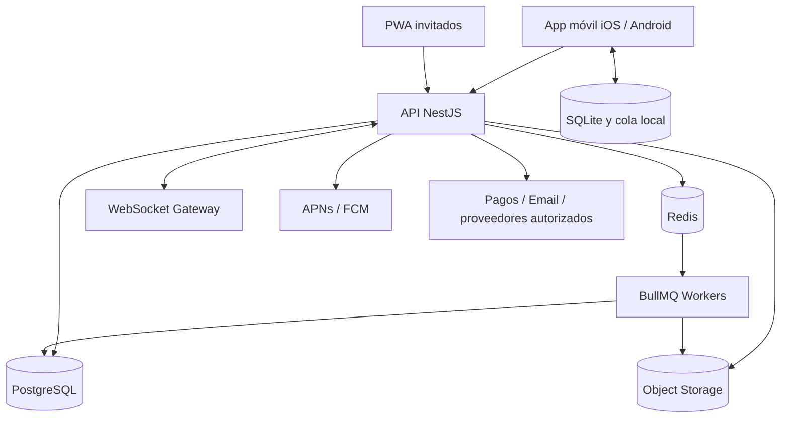

# 02. Arquitectura técnica

## Estilo
Arquitectura modular por dominios, API-first y offline-first. Empezar con un **monolito modular NestJS** y workers separados por proceso; extraer microservicios solo si métricas y necesidades operativas lo justifican.

## Stack de referencia
- Mobile: React Native + Expo Development Build + TypeScript.
- Web invitado: PWA TypeScript.
- Backend: NestJS + Node.js + TypeScript.
- Datos: PostgreSQL.
- Cache, coordinación y colas: Redis + BullMQ.
- Multimedia: object storage compatible con S3; Cloudflare R2 es candidato, no decisión irreversible.
- Tiempo real: WebSockets.
- Push: Expo Push inicialmente, con APNs/FCM en la entrega.
- Observabilidad: logs estructurados, métricas, trazas y alertas.

## Componentes y responsabilidades
**App móvil:** navegación, cámara/galería, sesión, base local (SQLite candidata), cola offline, reproducción multimedia, notificaciones y almacenamiento seguro de credenciales.

**PWA:** acceso mediante QR/enlace y subida de fotos en eventos. No prometer paridad nativa: background sync, cámara, notificaciones y cuotas varían por navegador/SO.

**Backend NestJS:** módulos identity, profiles, spaces, memberships, invitations, events, couples, circles, social, media, timeline, sync, notifications, audio, moderation, billing, admin y audit. REST versionada, WebSockets y OpenAPI.

**PostgreSQL:** fuente de verdad de identidad, permisos, relaciones, metadatos y estados duraderos.

**Redis/BullMQ:** caché, rate limits, coordinación efímera y procesamiento asíncrono; no reemplaza PostgreSQL.

**Object storage:** originales y derivados en buckets privados; backend emite URLs firmadas cortas después de autorizar.

**Workers:** inspección, validación, miniaturas, derivados, escaneo y tareas idempotentes.

## Vista lógica

## Límites
- PostgreSQL decide permisos y mantiene datos duraderos.
- Object storage guarda bytes, no decide quién puede verlos.
- El cliente no concede permisos.
- WebSocket no sustituye lectura/reconciliación por API.
- Workers y endpoints de reintento deben ser idempotentes.
- PWA y app comparten contratos, no necesariamente UI.

## Seguridad base
TLS, cifrado en reposo, buckets privados, URLs firmadas de corta duración, rate limiting, validación de archivos, secretos fuera de Git, mínimo privilegio, auditoría, backups y pruebas de restauración.

## Entornos
local, test, staging y production con credenciales, bases, buckets y claves separados.

## Decisiones de despliegue pendientes
Región, proveedor administrado de PostgreSQL, hosting, Redis, object storage, CDN, email, pagos y monitoreo deben elegirse comparando costos, límites, residencia de datos, recuperación y requisitos legales.
